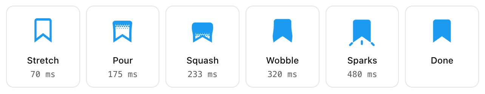
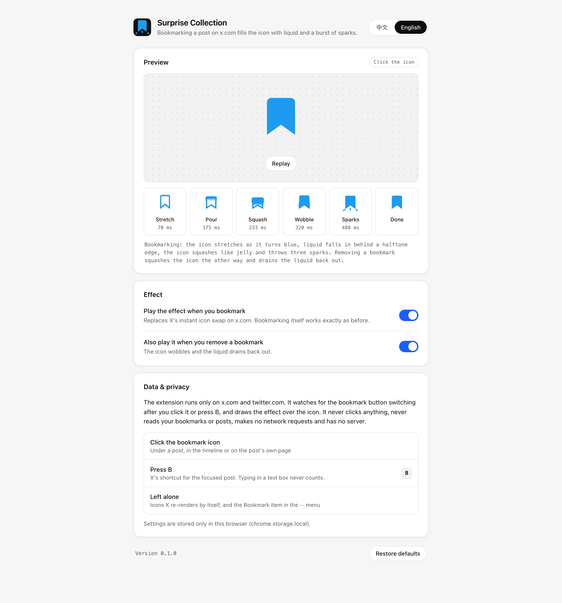

<div align="center">


# Surprise Collection

**Bookmarking a post on x.com fills the icon with liquid and throws a burst of sparks.**

<p>
  
  
  
  <a href="LICENSE"></a>
</p>

<p>
  <b>English</b> ·
  <a href="README.zh-CN.md">简体中文</a>
</p>

<p>
  <a href="#quick-start">Quick start</a> ·
  <a href="#the-effect">The effect</a> ·
  <a href="#features">Features</a> ·
  <a href="#settings">Settings</a> ·
  <a href="#how-it-works">How it works</a> ·
  <a href="#privacy">Privacy</a> ·
  <a href="#troubleshooting">Troubleshooting</a> ·
  <a href="#development">Development</a>
</p>

</div>

Surprise Collection is a Chrome extension for x.com. When you bookmark a post, X swaps the outline icon for a filled one in a single frame. Surprise Collection replaces that swap with the effect [@itsluneri showed](https://x.com/itsluneri/status/2116674589719675144): the icon stretches as it turns blue, liquid falls in behind a halftone edge, the icon squashes like jelly as the liquid lands, a bulge runs down it, and three sparks fly out below it. Removing a bookmark squashes it the other way and drains the liquid back out. Every curve was measured frame by frame from that video.

Bookmarking itself works exactly as before. The extension only draws over the icon while the effect plays. It runs only on x.com and twitter.com, asks for no permission besides `storage`, and makes no network requests.

## Quick start

You need desktop Chrome 120 or later, and Node.js 22.18 or later with npm to build.

### 1. Build

```bash
git clone https://github.com/occcat/surprise-collection.git
cd surprise-collection
npm install
npm run build
```

The extension is now in the `dist/` folder.

### 2. Load it in Chrome

1. Open `chrome://extensions`.
2. Turn on **Developer mode** in the top right.
3. Click **Load unpacked** and select the **`dist`** folder inside the repo, not the repo folder itself.

> [!IMPORTANT]
> If Chrome says **"Manifest file is missing or unreadable"**, you selected `surprise-collection/`. Select `surprise-collection/dist/` instead. `npm run build` prints the full path to choose.

### 3. Try it

1. Open x.com. Reload x.com tabs that were open before you installed the extension.
2. Click the bookmark icon under any post, or focus a post and press <kbd>B</kbd>.
3. Click it again to remove the bookmark and watch the liquid drain.

Click the extension's toolbar icon to open its settings, where you can also play the effect on a large icon.

### Update

```bash
git pull
npm install
npm run build
```

Then click the reload button on the extension's card in `chrome://extensions` and reload your x.com tabs.

## The effect

<div align="center">

<picture>
  <source media="(prefers-color-scheme: dark)" srcset="docs/screenshots/frames-dark.png" />
  
</picture>

</div>

| Phase | When | What happens |
|---|---|---|
| **Stretch** | 0–130 ms | The icon stretches 6 % taller and narrower while the outline turns from X's grey to its bookmarked blue. |
| **Pour** | 88–268 ms | Liquid falls in from the top, faster and faster. Its edge is a halftone: a row of tabs with thin slits between them, a row of large dots, then a row of small dots. |
| **Squash** | 150–300 ms | As the liquid lands, the icon squashes 13 % shorter and bulges out at the top. The bulge runs down the icon and flares its bottom. |
| **Wobble** | 300–620 ms | The icon rebounds 4 % taller and settles. |
| **Sparks** | 375–810 ms | When the bulge reaches the bottom, three sparks fly out of the bottom corners and from under the notch. Each stretches into a dash, thins, and fades. |

Removing a bookmark takes 540 ms: the icon stretches, then squashes 9 % with a bulge running up it while the liquid drains back out, and the outline and the last dots fade to grey.

## Features

| Feature | What it does |
|---|---|
| **Everywhere X shows a bookmark icon** | The timeline, a post's own page, replies, lists and the Bookmarks page. |
| **Click or <kbd>B</kbd>** | Plays when you click the icon, or press X's <kbd>B</kbd> shortcut on the focused post. <kbd>B</kbd> typed in a text box doesn't count. |
| **Only your bookmarks** | Icons X re-draws by itself, for example when a post's data refreshes, keep X's own swap. |
| **X's own colours and size** | The effect is drawn exactly over X's icon in its grey and blue, at whatever size X uses there. |
| **No flash** | X colours a new bookmark about a second after switching the icon. The effect stays on top until X has caught up, so the icon never blinks back to grey. |
| **Reduced motion** | If your system asks for reduced motion, x.com keeps X's own swap. |
| **Settings page** | A large icon you can click to play the effect, the phases frame by frame, two switches, English and Chinese, and **Restore defaults** with **Undo**. Changes reach open x.com tabs right away. |

## Settings

<div align="center">

<picture>
  <source media="(prefers-color-scheme: dark)" srcset="docs/screenshots/options-dark.png" />
  
</picture>

</div>

| Setting | Default | When off |
|---|---|---|
| **Play the effect when you bookmark** | On | x.com shows X's own icon swap. |
| **Also play it when you remove a bookmark** | On | Removing a bookmark shows X's own swap; bookmarking still plays. |
| **Language** | Your browser's language | Pick English or 中文 for the settings page. |

Settings are saved as soon as you change them.

## How it works

When X has saved a bookmark, it keeps the same button, changes its `data-testid` from `bookmark` to `removeBookmark`, and replaces the icon inside. The extension notes which button you clicked (or which post had focus when you pressed <kbd>B</kbd>). When that button switches within 5 seconds, it hides X's icon and draws the effect in its place, inside a shadow root so x.com's styles can't reach it. When the effect ends, X's icon comes back exactly as it was.

[docs/architecture.md](docs/architecture.md) explains each part, including how the liquid's edge, the bending and the sparks are drawn.

## Privacy

- Runs only on `x.com`, `mobile.x.com`, `twitter.com` and `mobile.twitter.com`.
- Notes which bookmark button you clicked, for up to 5 seconds, and reads the icon's position, size and colour.
- Never clicks or sends anything, and never reads your bookmarks, posts, messages or cookies.
- No network requests, no analytics, no server.
- Stores two switches and a language choice in `chrome.storage.local`.

See [PRIVACY.md](PRIVACY.md) for the full list of what it reads, stores and why it needs each permission.

## Troubleshooting

**"Manifest file is missing or unreadable" when loading.** You selected the repo folder. Select `dist/` inside it. If `dist/` doesn't exist yet, run `npm run build` first.

**`npm run build` fails with `ERR_UNKNOWN_FILE_EXTENSION ".ts"`.** Your Node.js is older than 22.18. The build imports TypeScript directly and needs Node 22.18 or later.

**The icon still swaps instantly.**

1. Reload x.com tabs that were open before you installed or updated the extension.
2. Open the extension's settings and check that **Play the effect when you bookmark** is on.
3. Check whether your system has reduced motion turned on (macOS: System Settings → Accessibility → Display → Reduce motion). The settings page says so when it is.
4. Check that the extension is enabled in `chrome://extensions`.
5. If it still happens, X may have changed how its bookmark button works. [docs/architecture.md#when-x-changes](docs/architecture.md#when-x-changes) explains how to check.

**Bookmarking from the ··· menu doesn't play.** That menu has no bookmark icon to fill, so it keeps X's behaviour.

## Development

| Command | What it does |
|---|---|
| `npm run build` | Build into `dist/` |
| `npm run watch` | Rebuild on every change |
| `npm run typecheck` | Type-check with `tsc` |
| `npm test` | Unit tests with `node --test` |
| `npm run test:e2e` | Load `dist/` into headless Chrome for Testing and check the effect on a local stand-in for x.com |
| `npm run screenshots` | Run the e2e checks and write the README images to `docs/screenshots/` |
| `npm run icons` | Redraw `icons/*.png` |

`test:e2e` uses Playwright's Chrome for Testing from `~/Library/Caches/ms-playwright`, because branded Chrome ignores `--load-extension`. Set `CHROME=/path/to/chrome` to use another build. It never reaches the real x.com.

```
src/
├── effect.ts           the effect as numbers: shapes, timing, bending, sparks, colours
├── render.ts           draws a frame as SVG
├── content.ts          watches the bookmark button on x.com and plays the effect over it
├── settings.ts         settings in chrome.storage.local, and which effect to play
├── i18n.ts             English and Chinese strings
├── background.ts       opens settings from the toolbar icon
├── manifest.json
├── _locales/           extension name and description
└── options/            settings page
test/
├── unit/               node --test
└── e2e/run.mjs         headless Chrome for Testing
scripts/icons.py        draws icons/
build.mjs               esbuild bundle into dist/
```

Read [AGENTS.md](AGENTS.md) before you contribute. It lists the project rules, the checks to run and the commit message format.

## Documentation

| Document | Contents |
|---|---|
| [docs/architecture.md](docs/architecture.md) | How X's button switches, the effect phase by phase, each module, the build, the tests, and what to check when X changes |
| [PRIVACY.md](PRIVACY.md) | What the extension reads and stores, and why it needs each permission |
| [AGENTS.md](AGENTS.md) | Project rules, checks and commit conventions for contributors and coding agents |
| [LICENSE](LICENSE) | MIT License |

## Credits

The effect recreates the one [@itsluneri](https://x.com/itsluneri) posted in ["Animations matter, even in a browser."](https://x.com/itsluneri/status/2116674589719675144). This extension is not affiliated with X or with them.

## License

[MIT](LICENSE)
