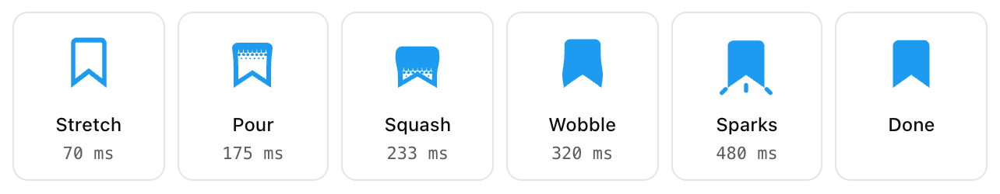
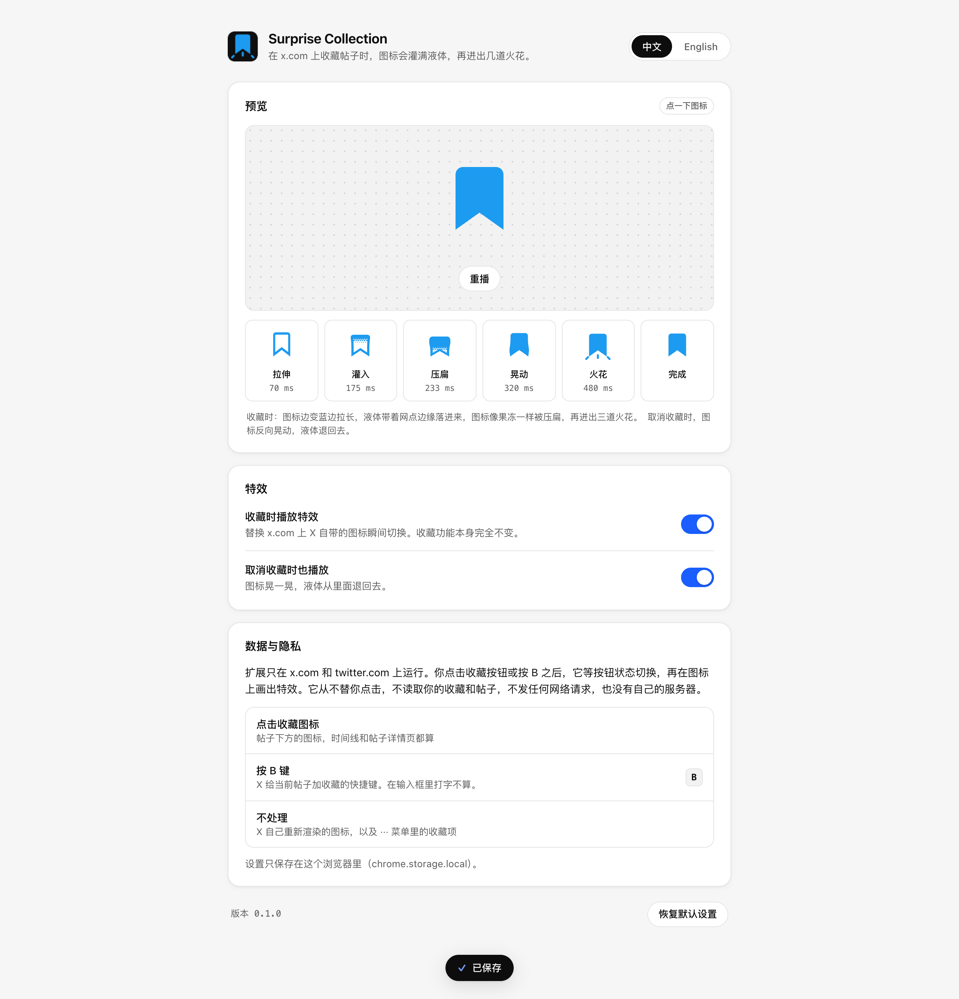

<div align="center">


# Surprise Collection

**在 x.com 上收藏帖子时，书签图标会灌满液体，再迸出几道火花。**

<p>
  
  
  
  <a href="LICENSE"></a>
</p>

<p>
  <a href="README.md">English</a> ·
  <b>简体中文</b>
</p>

<p>
  <a href="#快速上手">快速上手</a> ·
  <a href="#特效">特效</a> ·
  <a href="#特性">特性</a> ·
  <a href="#设置">设置</a> ·
  <a href="#工作原理">工作原理</a> ·
  <a href="#隐私">隐私</a> ·
  <a href="#常见问题">常见问题</a> ·
  <a href="#开发">开发</a>
</p>

</div>

Surprise Collection 是一个用于 x.com 的 Chrome 扩展。在 X 上收藏帖子时，书签图标会在一帧之内从空心换成实心。Surprise Collection 把这个切换换成 [@itsluneri 展示的特效](https://x.com/itsluneri/status/2116674589719675144)：图标边变蓝边拉长，液体带着网点状的边缘从上面落进来；液体落地时图标像果冻一样被压扁，一个鼓包从上往下跑过图标，最后下方迸出三道火花。取消收藏时，图标反向晃动，液体退回去。所有曲线都是从那段视频里逐帧测出来的。

收藏功能本身完全不变，扩展只在特效播放期间盖在图标上面画。它只在 x.com 和 twitter.com 上运行，除了 `storage` 不要任何权限，也不发任何网络请求。

## 快速上手

需要桌面版 Chrome 120 或更新版本；构建需要 Node.js 22.18 或更新版本和 npm。

### 1. 构建

```bash
git clone https://github.com/occcat/surprise-collection.git
cd surprise-collection
npm install
npm run build
```

扩展会生成在 `dist/` 文件夹里。

### 2. 在 Chrome 里加载

1. 打开 `chrome://extensions`。
2. 打开右上角的**开发者模式**。
3. 点**加载已解压的扩展程序**，选仓库里的 **`dist`** 文件夹，不是仓库文件夹本身。

> [!IMPORTANT]
> 如果 Chrome 提示 **"清单文件缺失或不可读取"**，说明你选的是 `surprise-collection/`，请改选 `surprise-collection/dist/`。`npm run build` 会打印出要选的完整路径。

### 3. 试一试

1. 打开 x.com。安装扩展之前就开着的 x.com 标签页需要刷新一下。
2. 点任意帖子下方的书签图标，或者选中一条帖子按 <kbd>B</kbd>。
3. 再点一次取消收藏，看液体退回去。

点工具栏上的扩展图标可以打开设置页，那里也能在一个大图标上播放特效。

### 更新

```bash
git pull
npm install
npm run build
```

然后在 `chrome://extensions` 里点扩展卡片上的刷新按钮，再刷新 x.com 标签页。

## 特效

<div align="center">

<picture>
  <source media="(prefers-color-scheme: dark)" srcset="docs/screenshots/frames-dark.png" />
  
</picture>

</div>

| 阶段 | 时间 | 发生了什么 |
|---|---|---|
| **拉伸** | 0–130 ms | 图标被拉高 6 %、变窄，同时空心图标从 X 的灰色变成收藏后的蓝色。 |
| **灌入** | 88–268 ms | 液体从顶部落进来，越落越快。液面边缘是网点：一排中间有细缝的方块，一排大圆点，再一排小圆点。 |
| **压扁** | 150–300 ms | 液体落地时，图标被压矮 13 %，顶部鼓出来；鼓包从上往下跑过图标，把底部撑开。 |
| **晃动** | 300–620 ms | 图标回弹，拉高 4 % 后停住。 |
| **火花** | 375–810 ms | 鼓包跑到底部时，三道火花从两个底角和缺口下方飞出，拉长成短线，变细，再淡出。 |

取消收藏用时 540 ms：图标先拉高，再压矮 9 %，同时一个鼓包从下往上跑、液体退回去，最后空心图标和剩下的网点一起淡回灰色。

## 特性

| 特性 | 说明 |
|---|---|
| **所有书签图标都生效** | 时间线、帖子详情页、回复、列表和书签页。 |
| **点击或按 <kbd>B</kbd>** | 点击图标，或在选中的帖子上按 X 的 <kbd>B</kbd> 快捷键都会播放。在输入框里打 B 不算。 |
| **只响应你的收藏** | X 自己重新渲染的图标（比如帖子数据刷新时）沿用 X 原本的切换。 |
| **X 自己的颜色和尺寸** | 特效正好盖在 X 的图标上，用 X 的灰色和蓝色，大小跟着 X 在每个位置用的尺寸走。 |
| **不闪烁** | X 在切换图标大约一秒之后才给新收藏上色。特效会一直盖在上面，等 X 跟上再交还，图标不会闪回灰色。 |
| **减少动态效果** | 系统开启「减少动态效果」时，x.com 上沿用 X 自己的切换。 |
| **设置页** | 一个可以点击播放特效的大图标、逐帧拆解、两个开关、中英文切换，以及带**撤销**的**恢复默认设置**。改动会立刻同步到已打开的 x.com 标签页。 |

## 设置

<div align="center">

<picture>
  <source media="(prefers-color-scheme: dark)" srcset="docs/screenshots/options-dark-zh.png" />
  
</picture>

</div>

| 设置 | 默认 | 关闭后 |
|---|---|---|
| **收藏时播放特效** | 开 | x.com 上显示 X 自己的图标切换。 |
| **取消收藏时也播放** | 开 | 取消收藏时显示 X 自己的切换，收藏时照常播放。 |
| **语言** | 跟随浏览器语言 | 设置页可选 English 或中文。 |

改动后立即保存。

## 工作原理

X 保存好收藏后，会保留同一个按钮，把它的 `data-testid` 从 `bookmark` 改成 `removeBookmark`，再换掉里面的图标。扩展会记下你点的是哪个按钮（或者按 <kbd>B</kbd> 时选中的是哪条帖子）。这个按钮在 5 秒内切换时，扩展把 X 的图标隐藏起来，在原位置画特效。特效画在 shadow root 里，x.com 的样式碰不到它。特效结束后，X 的图标原样恢复。

[docs/architecture.md](docs/architecture.md) 介绍了每个部分，包括液面、变形和火花是怎么画出来的。

## 隐私

- 只在 `x.com`、`mobile.x.com`、`twitter.com` 和 `mobile.twitter.com` 上运行。
- 记下你点的是哪个书签按钮，最多 5 秒；读取图标的位置、大小和颜色。
- 从不替你点击或发送任何东西，不读取你的收藏、帖子、私信或 Cookie。
- 不发网络请求，没有统计，没有服务器。
- 在 `chrome.storage.local` 里保存两个开关和语言选择。

[PRIVACY.md](PRIVACY.md) 列出了它读取和保存的全部内容，以及每项权限的用途。

## 常见问题

**加载时提示"清单文件缺失或不可读取"。** 你选的是仓库文件夹，请改选里面的 `dist/`。如果还没有 `dist/`，先运行 `npm run build`。

**`npm run build` 报 `ERR_UNKNOWN_FILE_EXTENSION ".ts"`。** Node.js 版本低于 22.18。构建脚本会直接导入 TypeScript，需要 Node 22.18 或更新版本。

**图标还是一下子就切换了。**

1. 刷新安装或更新扩展之前就打开的 x.com 标签页。
2. 打开扩展设置，确认**收藏时播放特效**是开着的。
3. 看看系统是否开启了「减少动态效果」（macOS：系统设置 → 辅助功能 → 显示 → 减少动态效果）。开启时设置页会有提示。
4. 在 `chrome://extensions` 里确认扩展已启用。
5. 如果还是不行，可能是 X 改了书签按钮的工作方式。[docs/architecture.md#when-x-changes](docs/architecture.md#when-x-changes) 说明了怎么检查。

**从 ··· 菜单收藏不播放。** 那个菜单里没有可以灌满的书签图标，所以保持 X 原样。

## 开发

| 命令 | 作用 |
|---|---|
| `npm run build` | 构建到 `dist/` |
| `npm run watch` | 改动后自动重新构建 |
| `npm run typecheck` | 用 `tsc` 做类型检查 |
| `npm test` | 用 `node --test` 跑单元测试 |
| `npm run test:e2e` | 把 `dist/` 加载进无头 Chrome for Testing，在本地模拟的 x.com 上检查特效 |
| `npm run screenshots` | 跑一遍 e2e 检查，并把 README 用的图片写到 `docs/screenshots/` |
| `npm run icons` | 重新绘制 `icons/*.png` |

`test:e2e` 使用 `~/Library/Caches/ms-playwright` 里 Playwright 的 Chrome for Testing，因为正式版 Chrome 会忽略 `--load-extension`。可以设置 `CHROME=/path/to/chrome` 换用其他版本。它不会访问真正的 x.com。

```
src/
├── effect.ts           用数字描述特效：形状、时间、变形、火花、颜色
├── render.ts           把一帧画成 SVG
├── content.ts          在 x.com 上监听书签按钮，并在上面播放特效
├── settings.ts         chrome.storage.local 里的设置，以及该播放哪段特效
├── i18n.ts             中英文文案
├── background.ts       点击工具栏图标时打开设置
├── manifest.json
├── _locales/           扩展名称和描述
└── options/            设置页
test/
├── unit/               node --test
└── e2e/run.mjs         无头 Chrome for Testing
scripts/icons.py        绘制 icons/
build.mjs               用 esbuild 打包到 dist/
```

参与贡献前请先阅读 [AGENTS.md](AGENTS.md)，里面有项目规则、提交前要跑的检查和提交信息格式。

## 文档

| 文档 | 内容 |
|---|---|
| [docs/architecture.md](docs/architecture.md) | X 的书签按钮怎么切换、特效的每个阶段、各个模块、构建、测试，以及 X 改版后该检查什么 |
| [PRIVACY.md](PRIVACY.md) | 扩展读取和保存了什么，以及每项权限的用途 |
| [AGENTS.md](AGENTS.md) | 给贡献者和编程智能体的项目规则、检查和提交约定 |
| [LICENSE](LICENSE) | MIT 许可证 |

## 致谢

特效复刻自 [@itsluneri](https://x.com/itsluneri) 发布的 ["Animations matter, even in a browser."](https://x.com/itsluneri/status/2116674589719675144)。本扩展与 X 及原作者均无关联。

## 许可证

[MIT](LICENSE)
